# Suppier: Developer Workflow Manual (คู่มือการทำงานและผังการทำงานทั้งหมดของระบบ)

> **Enterprise Procurement & Requisition Platform for MinebeaMitsumi (Thailand) Co., Ltd.**  
> Target Facilities: Bang Pa-in (BPI) & Rojana Plant Operations  
> Document Version: 2.0.0 (Comprehensive System Workflows)  
> Applicable Services: Frontend (Angular 18), Backend (Express.js :5000), AI Quotation Microservice (Python FastAPI :8000)

---

## 📑 Table of Contents

1. [System Macro-Architecture & Orchestration Workflow](#1-system-macro-architecture--orchestration-workflow)
   - 1.1 Tri-Service Runtime Topology
   - 1.2 System Bootstrapping & Launcher Lifecycle (`start.bat` / `stop.bat`)
   - 1.3 Communication Protocol & API Gateway Matrix
   - 1.4 Role-Based Operational Persona Matrix
2. [End-to-End Core System Workflows (Detailed Mermaid Sequences)](#2-end-to-end-core-system-workflows)
   - [WF-01: Employee OTP Authentication & Session Bootstrapping](#wf-01-employee-otp-authentication--session-bootstrapping)
   - [WF-02: Requisition Header & Item Grid Lifecycle (CRUD & Atomic Persistence)](#wf-02-requisition-header--item-grid-lifecycle-crud--atomic-persistence)
   - [WF-03: Technical Drawing & Document Attachment Ingestion](#wf-03-technical-drawing--document-attachment-ingestion)
   - [WF-04: Purchasing Aggregation & MinebeaMitsumi Branded Email Builder](#wf-04-purchasing-aggregation--minebeamitsumi-branded-email-builder)
   - [WF-05: Google SERP & Shopee Hybrid Quotation Search Engine](#wf-05-google-serp--shopee-hybrid-quotation-search-engine)
   - [WF-06: Hybrid Vector & Lexical Search Pipeline (Port 8000)](#wf-06-hybrid-vector--lexical-search-pipeline-port-8000)
   - [WF-07: Conversational AI Procurement Copilot (RAG Pipeline)](#wf-07-conversational-ai-procurement-copilot-rag-pipeline)
   - [WF-08: Zero-Input Smart PDF Auto-Extraction & Batch Ingestion](#wf-08-zero-input-smart-pdf-auto-extraction--batch-ingestion)
   - [WF-09: Human-in-the-Loop (HITL) Staging, Validation & Curation](#wf-09-human-in-the-loop-hitl-staging-validation--curation)
   - [WF-10: Conversational Slot-Filling Agent for Automated RFQ / PR Generation](#wf-10-conversational-slot-filling-agent-for-automated-rfq--pr-generation)
   - [WF-11: Historical Price Trend Analytics & Anomaly Detection](#wf-11-historical-price-trend-analytics--anomaly-detection)
   - [WF-12: Quotation Expiration Lifecycle & Proactive Alert Scanner](#wf-12-quotation-expiration-lifecycle--proactive-alert-scanner)
   - [WF-13: 3D Flipping Employee ID Badge & 2026 Shift Calendar Navigation](#wf-13-3d-flipping-employee-id-badge--2026-shift-calendar-navigation)
   - [WF-14: Failover, Graceful Degradation & In-Memory Offline Modes](#wf-14-failover-graceful-degradation--in-memory-offline-modes)
3. [Data State Machines & Database Lifecycle Models](#3-data-state-machines--database-lifecycle-models)
   - 3.1 Requisition Document State Machine
   - 3.2 Quotation Aggregate Lifecycle
   - 3.3 Manual Quotation Demand Lifecycle
   - 3.4 HITL Staging Verification Lifecycle
   - 3.5 Database Schemas & Storage Topologies (MSSQL vs SQLite)
4. [Developer Implementation, Extension & Debugging Guide](#4-developer-implementation-extension--debugging-guide)
   - 4.1 How to Implement a New Feature End-to-End
   - 4.2 Automated Testing & Validation Workflows
   - 4.3 Structured Telemetry, Logging & Coding Standards
   - 4.4 Troubleshooting Runbook & Known Gotchas

---

## 1. System Macro-Architecture & Orchestration Workflow

### 1.1 Tri-Service Runtime Topology

Suppier operates as a decoupled, multi-tier hybrid system consisting of three autonomous runtimes working in unison:

```mermaid
graph TB
    subgraph Browser_Tier [Client Presentation Layer - Port 4200]
        SPA["Angular 18 Standalone SPA (app.component.ts)"]
        UI_REQ["Requisition Grid & Summary Panel"]
        UI_SRCH["Google / Shopee Hybrid Search Engine"]
        UI_PURCH["Purchase View & Outlook Email Builder"]
        UI_CARD["3D Employee Badge & 2026 Shift Calendar"]
        UI_COPILOT["AI Procurement Copilot Widget"]
        GW["api.service.ts (Unified Client Gateway)"]
    end

    subgraph Backend_Tier [Core Requisition & Auth Gateway - Node.js Express :5000]
        EXP["server.js (Express Application & 50MB Body Parser)"]
        AUTH_ROUTER["routes/auth.routes.js"]
        REQ_ROUTER["routes/requisition.routes.js"]
        AUTH_CTRL["controllers/auth.controller.js"]
        REQ_CTRL["controllers/requisition.controller.js"]
        DB_POOL["config/db.js (MSSQL Connection Pool)"]
        FS_ATTACH["backend/uploads/attachments/ (Local Disk)"]
    end

    subgraph AI_Microservice_Tier [Quotation Discovery & AI Engine - Python FastAPI :8000]
        API_APP["main.py -> src/interfaces/web_app.py"]
        APP_SVC["QuotationApplicationService (Orchestrator)"]
        INQ_SVC["QuotationInquiryService (RAG Copilot)"]
        SLOT_AGENT["SlotFillingAgent (Automated RFQ / PR)"]
        HITL_SVC["HitlVerificationService (Human-in-the-Loop)"]
        PRICE_SVC["PriceAnalyticsService (Price Trends & Alerts)"]
        PDF_PARSER["PdfDocumentReader (Smart Heuristic Parser)"]
        VISION_LLM["VisionLlmQuotationExtractor (Multi-modal)"]
        HYBRID_RERANK["HybridReranker (RRF + Cross-Encoder)"]
        BM25["BM25Index (Lexical Inverted Index)"]
        VEC_IDX["MemoryVectorIndex (FastEmbed 384-dim ONNX)"]
        CACHE_SEARCH["SearchCache (SHA-256 In-Memory)"]
        CACHE_INQ["InquiryCache (SHA-256 In-Memory)"]
        SQLITE_REPO["SqliteQuotationRepository (quotations.db)"]
        GEMINI_GEN["GeminiAnswerGenerator (gemini-2.5-flash)"]
    end

    subgraph Data_Storage_Tier [Enterprise Persistence & Fallback Stores]
        MSSQL[("Microsoft SQL Server PBGM8G\n[Suppier] DB")]
        CSV[("Master_Employee.csv (Offline Fallback)")]
        SQLITE_DB[("quotations.db (SQLite WAL Mode)")]
        PDF_VAULT[("storage/pdf/ (Vendor PDF Originals)")]
        STAGING_VAULT[("storage/staging/ (HITL Uncommitted Drafts)")]
    end

    %% Client Gateway Connections
    SPA --> GW
    GW -->|HTTP /api/auth/*| AUTH_ROUTER
    GW -->|HTTP /api/requisition/*| REQ_ROUTER
    GW -->|HTTP GET /api/search| API_APP
    GW -->|HTTP POST /api/inquiry/ask-json| API_APP
    GW -->|HTTP POST /api/quotations/extract-preview| API_APP
    GW -->|HTTP POST /api/quotations/batch-commit| API_APP

    %% Backend Routing & Persistence
    AUTH_ROUTER --> AUTH_CTRL
    REQ_ROUTER --> REQ_CTRL
    AUTH_CTRL --> DB_POOL
    REQ_CTRL --> DB_POOL
    REQ_CTRL -->|Disk Write| FS_ATTACH
    DB_POOL -->|TDS Port 1433| MSSQL
    AUTH_CTRL -.->|Fallback on Disconnect| CSV

    %% Microservice Routing & Persistence
    API_APP --> APP_SVC
    API_APP --> INQ_SVC
    API_APP --> SLOT_AGENT
    API_APP --> HITL_SVC
    API_APP --> PRICE_SVC
    APP_SVC --> HYBRID_RERANK
    HYBRID_RERANK --> BM25
    HYBRID_RERANK --> VEC_IDX
    APP_SVC --> CACHE_SEARCH
    INQ_SVC --> CACHE_INQ
    INQ_SVC --> GEMINI_GEN
    APP_SVC --> SQLITE_REPO
    SQLITE_REPO --> SQLITE_DB
    APP_SVC --> PDF_PARSER
    PDF_PARSER --> PDF_VAULT
    HITL_SVC --> VISION_LLM
    HITL_SVC --> STAGING_VAULT
```

---

### 1.2 System Bootstrapping & Launcher Lifecycle (`start.bat` / `stop.bat`)

The entire ecosystem is orchestrated via Windows batch automation:

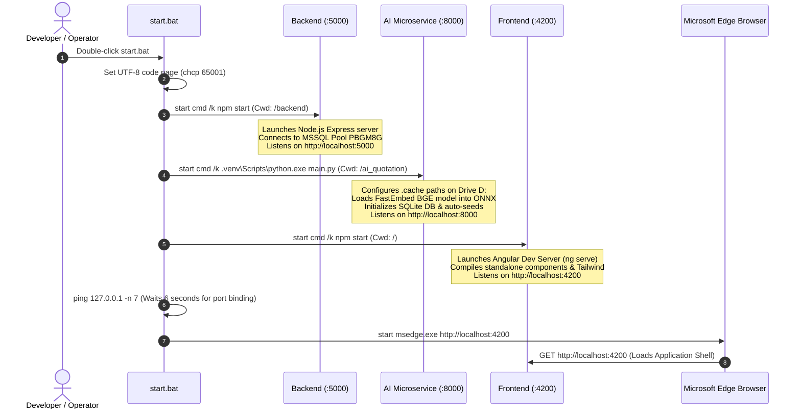

**Shutdown Sequence (`stop.bat`)**:
1. Locates process IDs bound to TCP ports `5000`, `8000`, and `4200` via `netstat -ano`.
2. Issues `taskkill /F /PID <pid>` for each service process.
3. Cleans temporary lock files to ensure graceful subsequent startups.

---

### 1.3 Communication Protocol & API Gateway Matrix

| Client Component | Target Service | Path / Endpoint | Protocol / Method | Payload Type | Purpose |
| :--- | :--- | :--- | :--- | :--- | :--- |
| [api.service.ts](file:///d:/suppier/Suppier/src/app/services/api.service.ts) | Backend (:5000) | `/api/auth/verify-employee` | HTTP POST | JSON (`{ employeeId }`) | Validates 5-digit employee code against `Master_Employee`. |
| [api.service.ts](file:///d:/suppier/Suppier/src/app/services/api.service.ts) | Backend (:5000) | `/api/requisition/account/:empNo` | HTTP GET | URL Param | Fetches current draft requisition and line items for logged-in user. |
| [api.service.ts](file:///d:/suppier/Suppier/src/app/services/api.service.ts) | Backend (:5000) | `/api/requisition/save-all` | HTTP POST | JSON (`{ header, items, empNo }`) | Atomic transactional upsert of header and all line items. |
| [api.service.ts](file:///d:/suppier/Suppier/src/app/services/api.service.ts) | Backend (:5000) | `/api/requisition/upload` | HTTP POST | JSON (`{ fileName, fileData }`) | Ingests Base64 file attachments up to 50MB to disk. |
| [api.service.ts](file:///d:/suppier/Suppier/src/app/services/api.service.ts) | Backend (:5000) | `/api/requisition/all` | HTTP GET | None | Fetches all pending quotations across plant for buyer review. |
| [api.service.ts](file:///d:/suppier/Suppier/src/app/services/api.service.ts) | AI Service (:8000) | `/api/search` | HTTP GET | Query Params (`query`, `user_role`) | Hybrid dense/sparse quotation search with role price masks. |
| [api.service.ts](file:///d:/suppier/Suppier/src/app/services/api.service.ts) | AI Service (:8000) | `/api/inquiry/ask-json` | HTTP POST | FormData (`query`, `user_role`) | RAG conversational inquiry answering via Gemini 2.5 Flash. |
| [api.service.ts](file:///d:/suppier/Suppier/src/app/services/api.service.ts) | AI Service (:8000) | `/api/quotations/extract-preview`| HTTP POST | Multipart/Form-Data (`file`) | Smart PDF extraction preview (Zero-input metadata extraction). |
| [api.service.ts](file:///d:/suppier/Suppier/src/app/services/api.service.ts) | AI Service (:8000) | `/api/quotations/batch-commit` | HTTP POST | JSON (`{ drafts }`) | Commits verified PDF quotation drafts into SQLite repository. |
| [api.service.ts](file:///d:/suppier/Suppier/src/app/services/api.service.ts) | AI Service (:8000) | `/api/chat/slot-filling` | HTTP POST | JSON (`{ session_id, message }`)| Multi-turn dialogue agent collecting RFQ/PR specifications. |
| [api.service.ts](file:///d:/suppier/Suppier/src/app/services/api.service.ts) | AI Service (:8000) | `/api/hitl/stage` | HTTP POST | Multipart/Form-Data (`file`) | Ingests PDF into uncommitted HITL staging vault. |
| [api.service.ts](file:///d:/suppier/Suppier/src/app/services/api.service.ts) | AI Service (:8000) | `/api/analytics/price-trend` | HTTP GET | Query Param (`part_query`) | Historical price trend analysis and anomaly detection. |

---

### 1.4 Role-Based Operational Persona Matrix

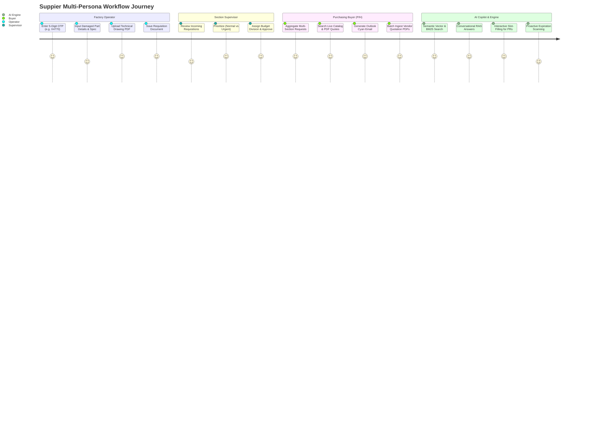

---

## 2. End-to-End Core System Workflows

### WF-01: Employee OTP Authentication & Session Bootstrapping

This workflow validates factory employees using their 5-digit badge number, animates the orbital convergence visual effect, loads their personalized identity, and restores the active requisition draft.

```mermaid
sequenceDiagram
    autonumber
    actor Emp as Factory Operator / Engineer
    participant UI as Login Screen (app.component.html)
    participant AC as AppComponent (app.component.ts)
    participant AS as ApiService (api.service.ts)
    participant BE as auth.controller.js (Port 5000)
    participant DB as MSSQL [Suppier].[dbo].[Master_Employee]
    participant CSV as Master_Employee.csv (Fallback)
    participant STORE as Browser localStorage

    Emp->>UI: Types 5-digit Employee ID (e.g., "X4770")
    UI->>AC: onCodeChange("X4770")
    AC->>AC: Regex check: /^[A-Z0-9]{5}$/
    AC->>UI: Sets loginPhase = 'rotating' (5 orbital nodes rotate at 72° offsets)
    AC->>UI: Sets loginPhase = 'converging' (Nodes smoothly collapse to center point)
    
    AC->>AS: verifyEmployee("X4770")
    AS->>BE: POST /api/auth/verify-employee { employeeId: "X4770" }
    
    alt MSSQL Database Online
        BE->>DB: SELECT e.*, d.Div_Name, s.Sec_Name FROM Master_Employee e ... WHERE Emp_No = 'X4770'
        DB-->>BE: Returns employee record (MR. DANUPHON SUTTHIWATTHANAK)
    else MSSQL Disconnected (Graceful Fallback)
        BE->>CSV: Stream & parse Master_Employee.csv for Emp_No == 'X4770'
        CSV-->>BE: Returns cached employee record
    end

    BE->>BE: cleanEmployeeName() -> "DANUPHON SUTTHIWATTHANAK"
    BE->>BE: Map Thai name "ดนุพล สุทธิวัฒนกุล", Division "MA", Section "M/M"
    BE-->>AS: 200 OK { success: true, user: EmployeeUser }
    AS-->>AC: Returns EmployeeUser payload

    AC->>UI: Sets loginPhase = 'downloading' (Progress counter 0% -> 100%)
    AC->>STORE: localStorage.setItem('suppier_emp_no', 'X4770')
    AC->>STORE: localStorage.setItem('suppier_user_profile', JSON.stringify(user))
    AC->>AC: currentUser = user, isLoggedIn = true
    
    AC->>AS: getDocumentByAccount("X4770")
    AS->>BE: GET /api/requisition/account/X4770
    BE-->>AS: 200 OK { header, items }
    AS-->>AC: Binds existing draft or personal empty template
    
    AC->>UI: Unmounts Login Screen; Mounts Master Header & Left Navigation
```

---

### WF-02: Requisition Header & Item Grid Lifecycle (CRUD & Atomic Persistence)

Manages line item insertion, real-time formula evaluation (Quantity × Price = Total), dynamic division budget checks, and atomic database persistence with transactional rollback safety.

```mermaid
sequenceDiagram
    autonumber
    actor Tech as Maintenance Engineer
    participant UI as Data Table Grid
    participant AC as AppComponent
    participant AS as ApiService
    participant BE as requisition.controller.js
    participant TX as SQL Server Transaction Manager
    participant DB as MSSQL Tables (Requisitions & RequisitionItems)

    Tech->>UI: Clicks "+ เพิ่มรายการ" (Add Line Item)
    UI->>AC: addRow()
    AC->>AC: Calculates next ItemNo, creates RequisitionItem with default status
    AC->>UI: Renders new row with item.isEditing = true
    
    Tech->>UI: Inputs PartName="AIR CYLINDER", Maker="SMC", Qty=2, UnitPrice=1450.00
    UI->>AC: calculateTotals()
    AC->>AC: item.amount = item.quantity * item.unitPrice (2900.00)
    AC->>AC: header.totalCost = sum(all active item amounts)
    AC->>UI: Re-renders sticky summary footer in real-time
    
    Tech->>UI: Clicks "บันทึกข้อมูลทั้งหมด" (Save Entire Document)
    UI->>AC: saveEntireDocument()
    AC->>AC: Validates header required fields (Division, Section, Date)
    AC->>AS: saveEntireDocument(docNumber, header, requisitionItems, empNo)
    AS->>BE: POST /api/requisition/save-all { header, items, empNo }

    BE->>TX: const transaction = new sql.Transaction(pool); await transaction.begin()
    
    rect rgb(240, 248, 255)
        Note over BE, DB: Atomic Transaction Boundary
        BE->>DB: MERGE INTO Requisitions (Header Record)
        BE->>DB: DELETE FROM RequisitionItems WHERE DocNumber = @docNumber
        loop For each item in items array
            BE->>DB: INSERT INTO RequisitionItems (DocNumber, ItemNo, PartName, Spec, Maker, Qty, Price, AttachmentsJson)
        end
    end

    alt Success on All Inserts
        BE->>TX: await transaction.commit()
        BE-->>AS: 200 OK { success: true, message: "บันทึกสำเร็จ" }
        AS-->>AC: Returns true
        AC->>AC: Sets isEditingAllRows = false, clears dirty snapshots
        AC->>UI: Displays green toast: "บันทึกข้อมูล Requisition และรายการทั้งหมดสำเร็จ"
    else Error Detected on Any Item
        BE->>TX: await transaction.rollback()
        BE-->>AS: 500 Error { success: false, message: "Database rollback triggered" }
        AS-->>AC: Returns false
        AC->>UI: Displays red error banner: "เกิดข้อผิดพลาดในการบันทึกข้อมูล กรุณาลองใหม่อีกครั้ง"
    end
```

---

### WF-03: Technical Drawing & Document Attachment Ingestion

Enables operators to attach CAD drawings, spec sheets, and vendor quote PDFs directly to any requisition line item.

```mermaid
sequenceDiagram
    autonumber
    actor Tech as Technician
    participant UI as Item Row File Input
    participant AC as AppComponent
    participant AS as ApiService
    participant BE as requisition.controller.js
    participant FS as Local Storage (/backend/uploads/attachments)

    Tech->>UI: Clicks "Attach Drawing" & selects "Cylinder_Mounting.pdf" (12MB)
    UI->>AC: onAttachmentFileSelected(event, itemIndex)
    AC->>AC: Validates file extension (.pdf, .jpg, .png, .dwg) and file size (<50MB)
    AC->>AC: Uses FileReader.readAsDataURL() -> Generates Base64 string
    
    AC->>AS: uploadAttachment({ fileName: "Cylinder_Mounting.pdf", fileData: "data:application/pdf;base64,..." })
    AS->>BE: POST /api/requisition/upload (Express body limit: 50MB)
    
    BE->>BE: Strips Base64 data URI scheme header
    BE->>BE: Generates unique collision-free filename: Date.now() + "_" + sanitizedName
    BE->>FS: fs.promises.writeFile(filePath, buffer)
    
    BE-->>AS: 200 OK { success: true, file: { fileName, originalName, url: "http://localhost:5000/uploads/attachments/..." } }
    AS-->>AC: Appends uploaded file metadata to item.attachments array
    AC->>AC: Marks item as dirty (unsaved changes)
    AC->>UI: Renders clickable attachment badge with preview/download link
```

---

### WF-04: Purchasing Aggregation & MinebeaMitsumi Branded Email Builder

Purchasing officers (P/H section) aggregate quotation requests from multiple departments, filter them, and generate an Outlook-ready HTML table styled in authentic MinebeaMitsumi corporate cyan.

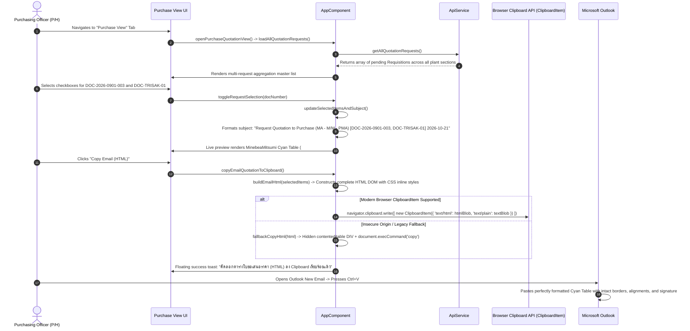

---

### WF-05: Google SERP & Shopee Hybrid Quotation Search Engine

The unified search experience combines Google's fast SERP layout with Shopee's visual e-commerce product grid, complete with 1-click requisition cart import.

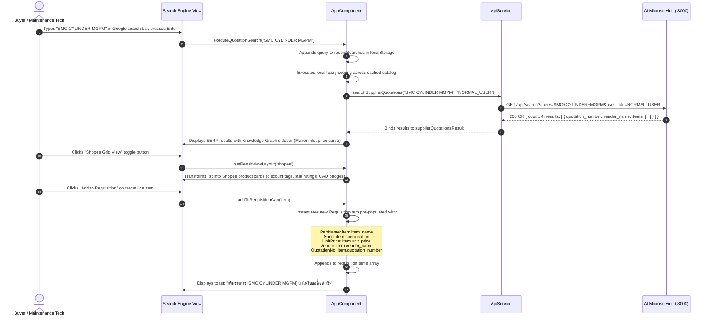

---

### WF-06: Hybrid Vector & Lexical Search Pipeline (Port 8000)

The search engine inside `ai_quotation` executes a two-stage hybrid retrieval strategy: fast in-memory caching, parallel dense semantic vector retrieval via FastEmbed ONNX, sparse keyword matching via BM25, Reciprocal Rank Fusion (RRF), and Cross-Encoder reranking.

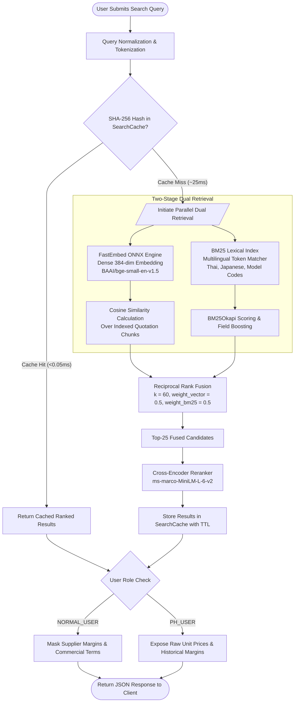

---

### WF-07: Conversational AI Procurement Copilot (RAG Pipeline)

The AI Copilot operates a Retrieval-Augmented Generation (RAG) architecture grounded strictly in verified vendor quotation documents.

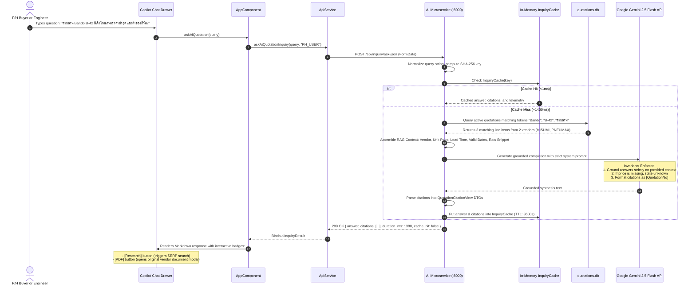

---

### WF-08: Zero-Input Smart PDF Auto-Extraction & Batch Ingestion

Allows purchasing officers to drag and drop multiple vendor quotation PDFs without manual typing. The engine automatically detects the vendor header, converts Buddhist Era to Gregorian years, parses item tables, and registers them in the database.

```mermaid
sequenceDiagram
    autonumber
    actor Officer as Purchasing Officer (P/H)
    participant PORTAL as PH Workbench Portal
    participant MS as AI Microservice (:8000)
    participant RDR as PdfDocumentReader (pdf_reader.py)
    participant SQLITE as SqliteQuotationRepository
    participant VEC as Vector & BM25 Indexes

    Officer->>PORTAL: Drags and drops 10 PDF quotation files
    PORTAL->>MS: POST /api/quotations/batch-preview (multipart/form-data)
    
    loop For each uploaded PDF file
        MS->>RDR: extract_draft(pdf_bytes, filename)
        RDR->>RDR: PyPDF extracts text stream & SHA-256 fingerprint
        RDR->>RDR: Detect vendor via header regex & tax ID heuristics (e.g. SMC, MISUMI)
        RDR->>RDR: Convert Buddhist Era dates: if year > 2400 then year = year - 543
        RDR->>RDR: Tabular bounding box parser extracts lines: ItemNo, PartName, Spec, Qty, Price
        RDR-->>MS: Returns ExtractedQuotationDraft DTO
    end

    MS-->>PORTAL: 200 OK with extracted preview table for all 10 documents
    Officer->>PORTAL: Reviews extracted drafts, adjusts any ambiguous field, clicks "Confirm All Ingestions"
    PORTAL->>MS: POST /api/quotations/batch-commit { drafts: [...] }
    
    MS->>SQLITE: Batch INSERT into quotations and quotation_items
    MS->>VEC: Trigger incremental FastEmbed dense embedding & BM25 index refresh
    MS-->>PORTAL: 200 OK { success: true, count: 10 }
    PORTAL->>Officer: Displays green success banner; updates active KPI dashboard
```

---

### WF-09: Human-in-the-Loop (HITL) Staging, Validation & Curation

When a vendor quotation PDF has irregular formatting, handwriting, or low extraction confidence, it is routed into the Human-in-the-Loop staging vault where procurement specialists can review, edit, and audit before final database commitment.

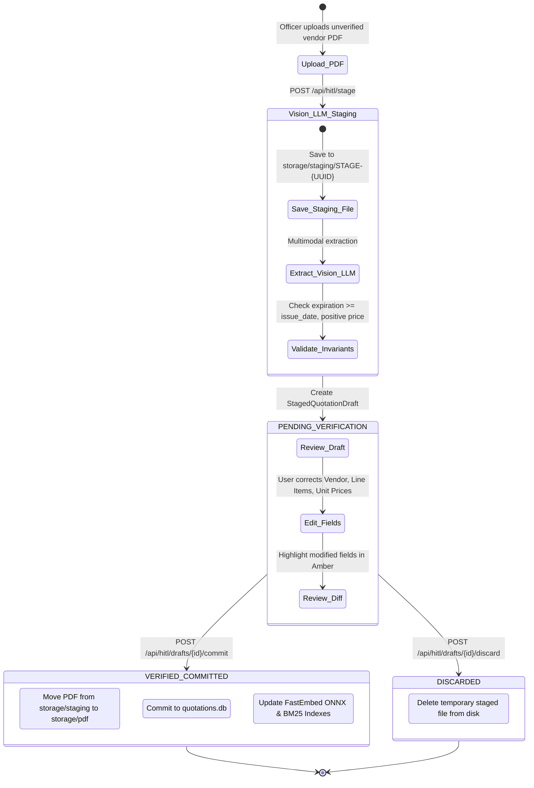

---

### WF-10: Conversational Slot-Filling Agent for Automated RFQ / PR Generation

When an engineer searches for a spare part that does not exist in the database, the conversational Slot-Filling Agent automatically intervenes to collect missing requirements and draft a Purchase Requisition (PR) / Request for Quotation (RFQ).

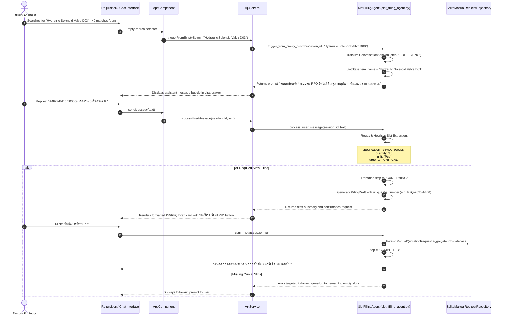

---

### WF-11: Historical Price Trend Analytics & Anomaly Detection

Procurement analysts query historical quotation records to detect price spikes, downward trends, and vendor pricing variations before issuing purchase orders.

```mermaid
flowchart TD
    QUERY([User Requests Price Trend for Component]) --> FETCH[Query Sqlite Database for all line items matching Part/Spec]
    FETCH --> SORT[Sort Historical Price Points by Date Ascending]
    
    subgraph Analytics_Calculation [PriceAnalyticsService]
        SORT --> STATS[Compute Statistical Metrics:\n- Minimum Price\n- Maximum Price\n- Average Price\n- Latest Price]
        STATS --> DIFF[Calculate Price Change Percentage:\n((Latest - Avg) / Avg) * 100]
        
        DIFF --> DIRECTION{Evaluate Trend Direction}
        DIRECTION -- Change > +5% --> DIR_UP[Trend: UP\nFlag Potential Cost Increase]
        DIRECTION -- Change < -5% --> DIR_DOWN[Trend: DOWN\nFlag Favorable Negotiation Window]
        DIRECTION -- Between -5% and +5% --> DIR_STABLE[Trend: STABLE\nStable Historical Pricing]
    end
    
    DIR_UP --> ANOMALY{Is Latest Price > 1.25 * Max Previous?}
    DIR_DOWN --> REC
    DIR_STABLE --> REC
    
    ANOMALY -- Yes --> ALERT[Generate SystemAlert: PRICE_INCREASE\nSeverity: WARNING]
    ANOMALY -- No --> REC[Synthesize Procurement Recommendation]
    
    ALERT --> OUT([Return PriceTrendAnalysis & Recommendation DTO])
    REC --> OUT
```

---

### WF-12: Quotation Expiration Lifecycle & Proactive Alert Scanner

Ensures the factory never issues requisitions against expired or superseded vendor quotation agreements.

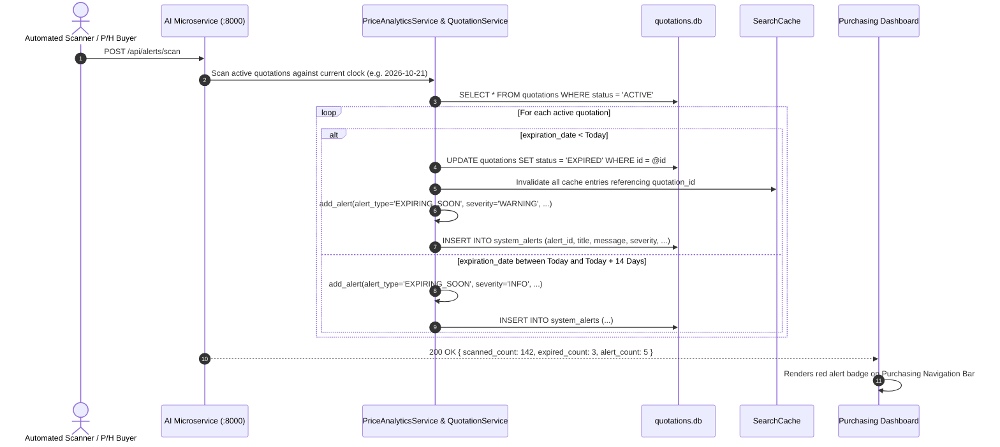

---

### WF-13: 3D Flipping Employee ID Badge & 2026 Shift Calendar Navigation

The user's official MinebeaMitsumi badge features hardware-accelerated 3D CSS perspective transforms, rotating through front credentials, H1 factory calendar, and H2 factory calendar.

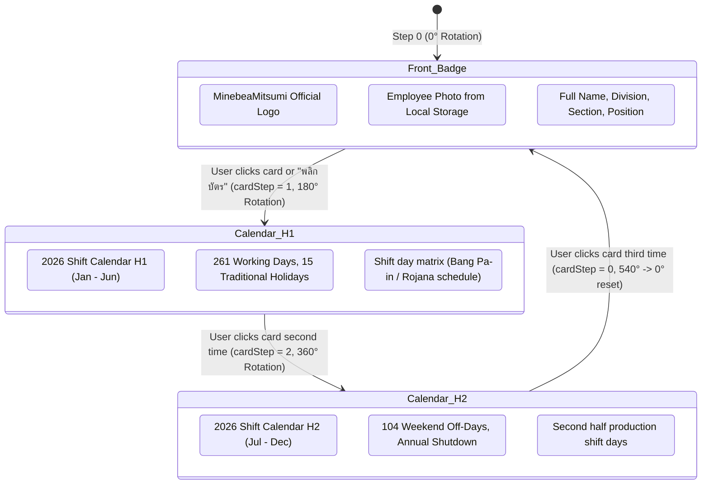

---

### WF-14: Failover, Graceful Degradation & In-Memory Offline Modes

The platform incorporates zero-crash architectural safeguards, ensuring full operational availability even during network disconnects or database maintenance.

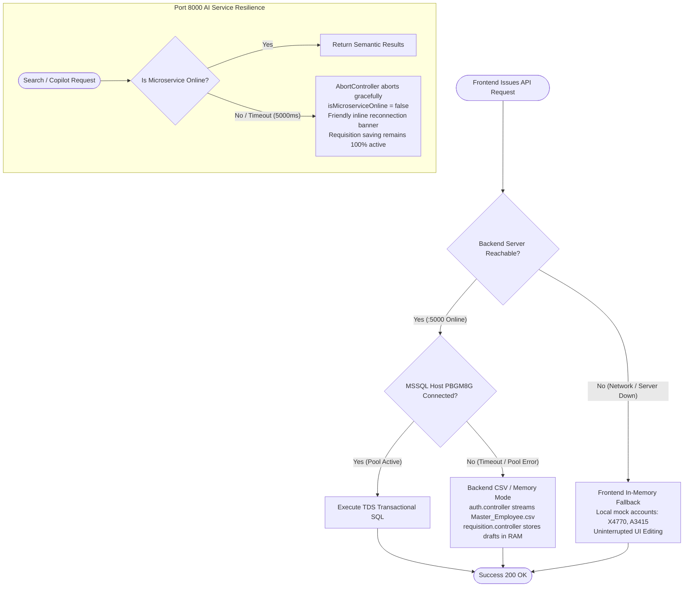

---

## 3. Data State Machines & Database Lifecycle Models

### 3.1 Requisition Document State Machine

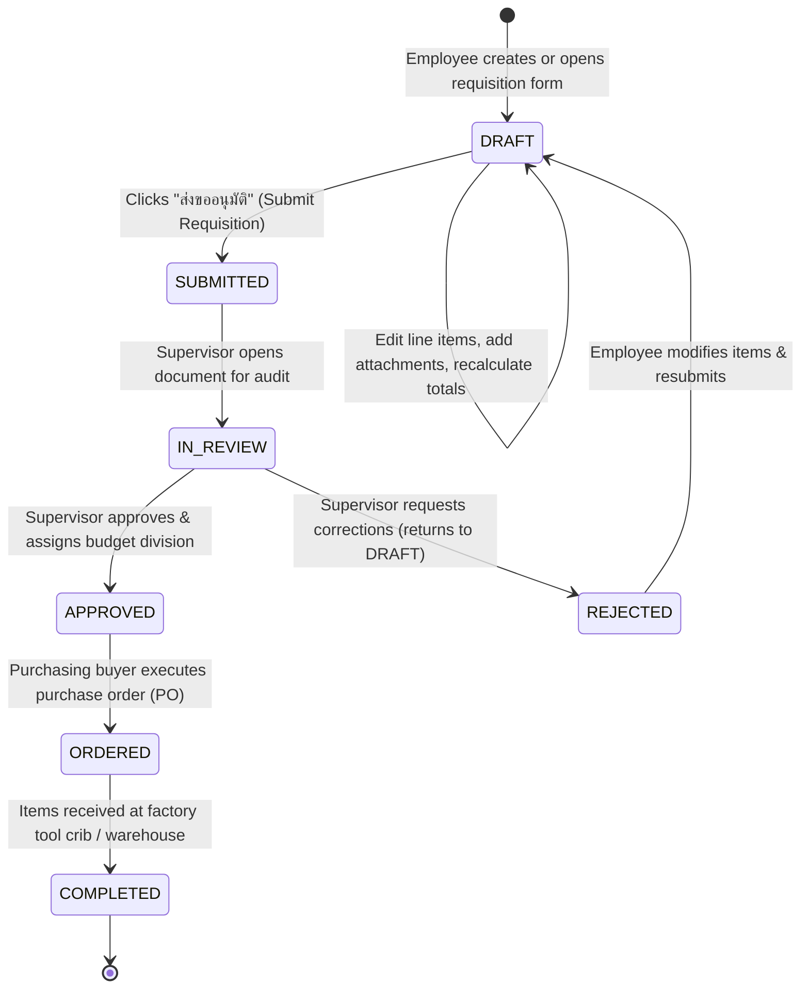

---

### 3.2 Quotation Aggregate Lifecycle

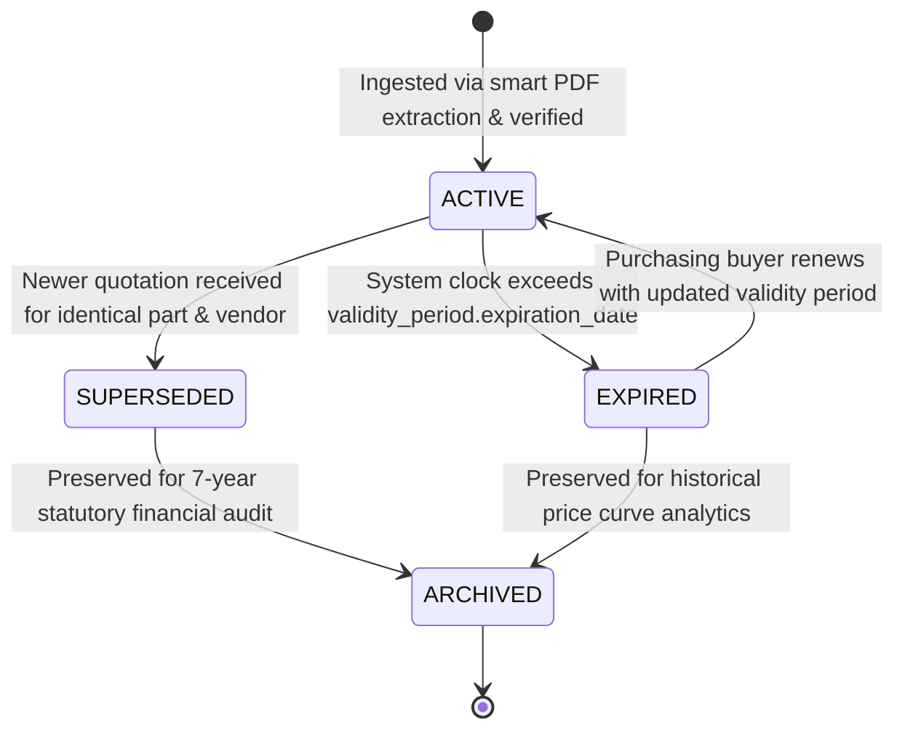

---

### 3.3 Manual Quotation Demand Lifecycle

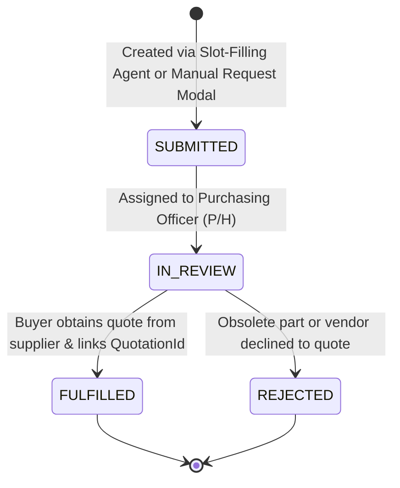

---

### 3.4 HITL Staging Verification Lifecycle

```mermaid
stateDiagram-v2
    [*] --> PENDING_VERIFICATION: PDF ingested into storage/staging/
    PENDING_VERIFICATION --> PENDING_VERIFICATION: Buyer adjusts fields (Vendor, Qty, Price)
    PENDING_VERIFICATION --> VERIFIED_COMMITTED: All validation warnings resolved & committed
    PENDING_VERIFICATION --> DISCARDED: Unreadable or duplicate document rejected
    VERIFIED_COMMITTED --> [*]
    DISCARDED --> [*]
```

---

### 3.5 Database Schemas & Storage Topologies

#### MSSQL Server (`PBGM8G` / `Suppier` Database)
- **`Master_Employee`**: Central directory of all factory personnel (`Emp_No`, `Emp_Name`, `Thai_Name`, `Div_Code`, `Sec_Code`, `Process_Code`, `Position_Group`, `Shift_Group`).
- **`Requisitions`**: Document header table (`DocNumber`, `DocDate`, `EmpNo`, `Division`, `Section`, `Priority`, `TotalCost`, `Status`, `UpdatedAt`).
- **`RequisitionItems`**: Line items detail table (`Id`, `DocNumber`, `ItemNo`, `PartName`, `Spec`, `Maker`, `Vendor`, `Quantity`, `UnitPrice`, `Amount`, `AttachmentsJson`).

#### SQLite Microservice Database (`ai_quotation/quotations.db`)
- **`quotations`**: Master quotation aggregate (`quotation_id`, `vendor_name`, `issue_date`, `expiration_date`, `currency`, `total_amount`, `pdf_filename`, `pdf_sha256`, `status`).
- **`quotation_items`**: Extracted line items (`item_id`, `quotation_id`, `item_no`, `part_name`, `specification`, `quantity`, `unit_price`, `currency`).
- **`manual_quotation_requests`**: Unfulfilled demands (`request_id`, `requester_id`, `item_name`, `specification`, `urgency`, `status`, `created_at`).
- **`system_alerts`**: Event-driven notifications (`alert_id`, `alert_type`, `title`, `message`, `severity`, `related_quotation_id`, `created_at`, `is_read`).

---

## 4. Developer Implementation, Extension & Debugging Guide

### 4.1 How to Implement a New Feature End-to-End

When adding a full-stack capability (e.g., adding a new procurement approval tier):

1. **Step 1: Database Migration / Entity Definition**:
   - For relational MSSQL changes: update query definitions in [backend/controllers/requisition.controller.js](file:///d:/suppier/Suppier/backend/controllers/requisition.controller.js).
   - For AI microservice: define aggregate or value object under [ai_quotation/src/domain/](file:///d:/suppier/Suppier/ai_quotation/src/domain/).

2. **Step 2: Backend Controller & Routing**:
   - Add controller method in [backend/controllers/requisition.controller.js](file:///d:/suppier/Suppier/backend/controllers/requisition.controller.js).
   - Register REST route in [backend/routes/requisition.routes.js](file:///d:/suppier/Suppier/backend/routes/requisition.routes.js).

3. **Step 3: Frontend API Gateway Integration**:
   - Add typed method in [src/app/services/api.service.ts](file:///d:/suppier/Suppier/src/app/services/api.service.ts) wrapped with `try...catch` and fallback behavior.

4. **Step 4: Frontend Component & Template**:
   - Add reactive state variable and handler in [src/app/app.component.ts](file:///d:/suppier/Suppier/src/app/app.component.ts).
   - Bind interactive UI elements in [src/app/app.component.html](file:///d:/suppier/Suppier/src/app/app.component.html).

5. **Step 5: Automated Test Verification**:
   - Run Python test suite: `uv run pytest` in `/ai_quotation`.
   - Run Angular specs: `npm test` in project root.

---

### 4.2 Automated Testing & Validation Workflows

```bash
# ==============================================================================
# 1. AI Quotation Microservice Test Suite (Unit, Integration, RAG, Reranker)
# ==============================================================================
cd d:\suppier\Suppier\ai_quotation
.venv\Scripts\python.exe -m pytest -v

# Run targeted reranker and search fusion tests
.venv\Scripts\python.exe -m pytest tests/unit/infrastructure/test_reranker.py -v

# Run conversational slot-filling agent test
.venv\Scripts\python.exe -m pytest tests/unit/application/test_slot_filling_agent.py -v

# Run smart PDF auto-extraction heuristics test
.venv\Scripts\python.exe -m pytest tests/unit/infrastructure/test_smart_pdf_extraction.py -v

# ==============================================================================
# 2. End-to-End Playwright Automated Browser Journey
# ==============================================================================
.venv\Scripts\python.exe -m pytest tests/e2e/test_playwright_e2e.py -v

# ==============================================================================
# 3. Frontend Angular Specs
# ==============================================================================
cd d:\suppier\Suppier
npm test -- --watch=false --browsers=ChromeHeadless
```

---

### 4.3 Structured Telemetry, Logging & Coding Standards

In accordance with project governance rules:
- **Rule 1 (Transparency)**: Every API controller, service method, and search pass must log structured milestones (`[INFO]`, `[WARN]`, `[ERROR]`, `[AGENT]`).
- **Rule 2 (No Emoji)**: Plain ASCII status indicators only (`[OK]`, `[WARN]`, `[ERROR]`, `[AGENT]`). Never use graphical emojis in log outputs or commit messages to prevent Windows terminal character corruption.
- **Rule 5 (Fail-Safe Offline Mode)**: Never allow a remote database connection failure to crash the user's active session.

---

### 4.4 Troubleshooting Runbook & Known Gotchas

| Symptom | Probable Cause | Diagnostic Command & Resolution |
| :--- | :--- | :--- |
| **Port 5000 or 8000 Already in Use** | An orphaned node or python process from a prior session | Run `netstat -ano \| findstr :5000` or `:8000` in PowerShell, then terminate with `taskkill /F /PID <pid>`. Or execute `stop.bat`. |
| **HuggingFace / ONNX Model Out of Disk Space** | Models downloading to full C: drive default directory | [ai_quotation/main.py](file:///d:/suppier/Suppier/ai_quotation/main.py) explicitly redirects cache to `d:\suppier\Suppier\ai_quotation\.cache`. Verify directory exists and drive D: has sufficient free space. |
| **File Upload Truncated / HTTP 413 Error** | Express body parser payload default limit exceeded | [backend/server.js](file:///d:/suppier/Suppier/backend/server.js) sets `express.json({ limit: '50mb' })`. Ensure large attachments do not exceed 50MB. |
| **Microservice Shows Offline in UI** | FastAPI process not started or Python venv missing | Run `.venv\Scripts\python.exe main.py` manually in `ai_quotation/` to observe terminal startup diagnostics. |
| **Thai Buddhist Era Date Error in Requisition** | Vendor PDF quotes dated `2569` causing invalid ISO date | [pdf_reader.py](file:///d:/suppier/Suppier/ai_quotation/src/infrastructure/pdf_reader.py) automatically converts years $> 2400$ by subtracting 543. If a new vendor format is introduced, verify regex pattern in `_parse_date_heurstic()`. |
