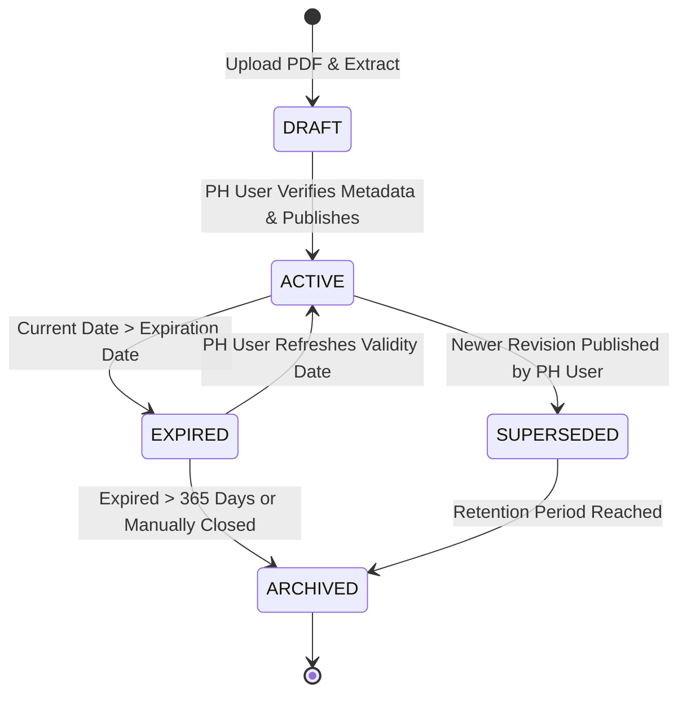
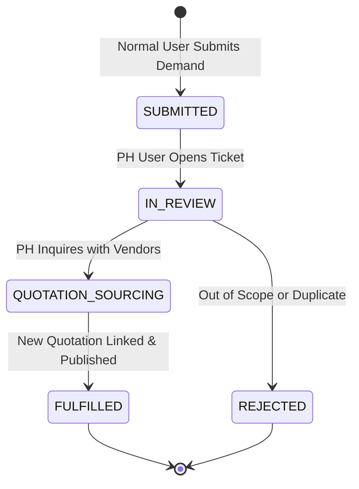
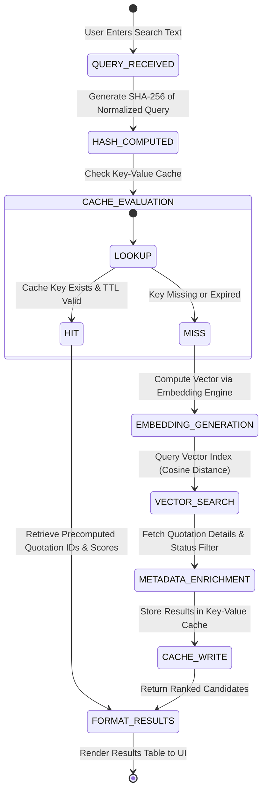
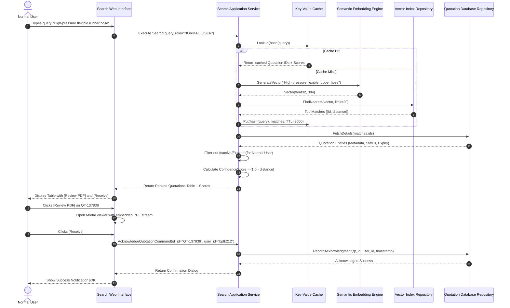
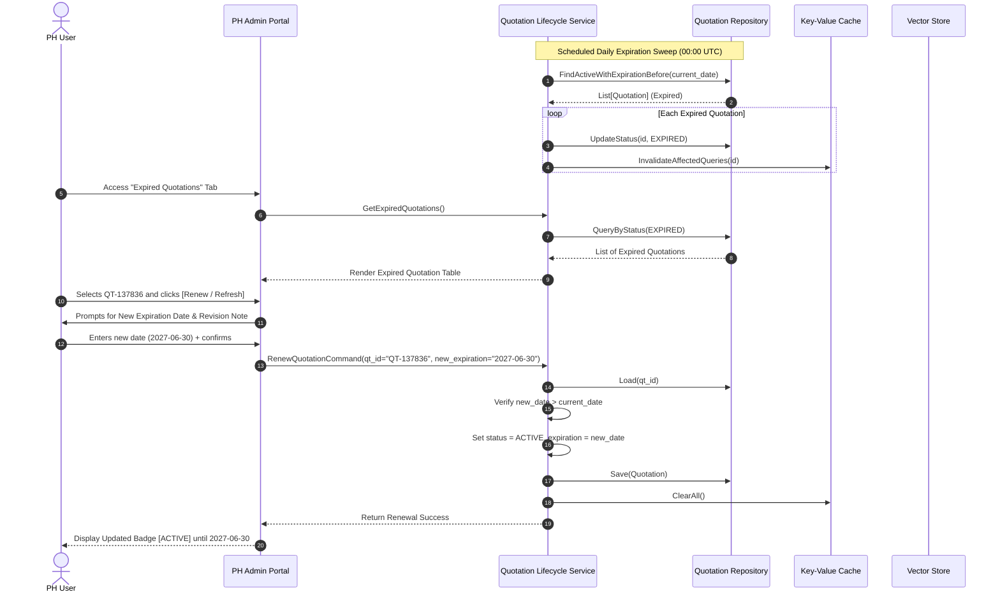
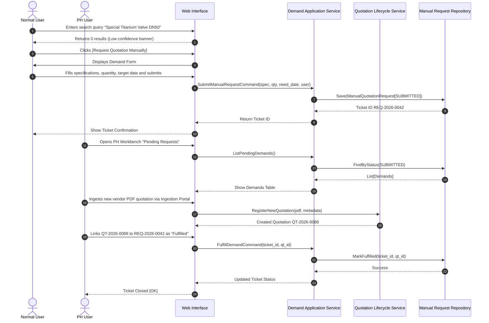

# System Requirements, Architecture, and UI Specification

Document Version: 1.0.0  
Status: APPROVED DRAFT (STATE: DISCOVERY)  
Author: Antigravity Autonomous Agent  
Repository: quotation_search  

---

## 1. System Vision and Objectives

The Quotation Discovery and Lifecycle Engine is an intelligent, centralized web application inspired by Google Search. It empowers enterprise staff ("Normal Users") to discover commercial vendor quotations through semantic intent search, view high-fidelity PDF documents, and register procurement demands. Concurrently, it equips the Purchasing Hub ("PH Users") with an administrative workbench to ingest documents, extract and curate metadata, monitor expiration lifecycles, and refresh outdated commercial agreements.

### Core Objectives
1. **Semantic Search Capability**: Beyond literal substring matching, leverage vector embeddings to understand technical equivalence, vendor terminology, and cross-lingual part descriptors.
2. **Deterministic Confidence Metric**: Present each search match with an auditable confidence score (0.0% to 100.0%) indicating semantic relevance.
3. **High-Performance Caching & Indexing**: Employ dual-layer caching (in-memory Key-Value store for queries and vector embeddings) alongside inverted lexical indexing.
4. **Lifecycle & Expiry Governance**: Automatically transition quotations past their validity date into an `EXPIRED` state, preventing unauthorized receipt while surfacing renewal queues to PH users.
5. **Role-Enforced Workflows**: Maintain strict isolation between Normal Users (Search, View, Receive, Request Manual) and PH Users (Ingestion, Refresh, Metadata Curation, Fulfillment).

---

## 2. Ubiquitous Language (Domain Glossary)

In accordance with Domain-Driven Design principles, the following terminology is strictly enforced across domain logic, databases, tests, and user interfaces (Rule R2: No generic manager/handler/helper/util suffixes).

- **Quotation**: The formal aggregate representing a commercial offer from a vendor, consisting of unique identification, vendor details, validity bounds, line items, total monetary value, and a reference to the source PDF document.
- **QuotationId**: A strongly typed value object uniquely identifying a quotation in the system (e.g., `QT-2026-00129`).
- **ValidityPeriod**: A value object defined by an `issue_date` and an `expiration_date`. Enforces the invariant that `expiration_date >= issue_date`.
- **QuotationStatus**: Lifecycle state enumeration: `ACTIVE`, `EXPIRED`, `SUPERSEDED`, `ARCHIVED`.
- **ConfidenceScore**: A normalized numerical value object between `0.000` and `1.000` reflecting cosine similarity between query embedding and quotation vector.
- **EmbeddingVector**: An array of floating-point values generated from quotation text representations for similarity calculation.
- **SearchCacheRecord**: A key-value pair storing query cryptographic hashes against precomputed quotation candidate IDs and scores.
- **ManualQuotationRequest**: An aggregate representing an unfulfilled user demand when a search fails or returns low confidence. Includes requester identity, part name, technical specifications, and target timeframe.
- **RequestStatus**: State of a manual demand: `SUBMITTED`, `IN_REVIEW`, `FULFILLED`, `REJECTED`.
- **QuotationAcknowledgment ("Receive")**: A recorded domain event indicating that a Normal User has selected and claimed an active quotation for purchase requisition.
- **QuotationRenewal**: The business operation performed by a PH user to update an expired quotation's validity period with a newly agreed vendor date or revision.

---

## 3. Bounded Contexts and Mental Layering Model

### 3.1 Bounded Contexts
The system is partitioned into three decoupled bounded contexts communicating strictly via Domain Events or explicit Anti-Corruption Layers (ACL):

1. **Discovery & Semantic Search Context**:
   - Manages text tokenization, embedding generation, vector indexing, query caching, and similarity scoring.
   - Read-only projection of published quotation metadata.
2. **Quotation Lifecycle & Governance Context**:
   - Owns the `Quotation` aggregate, validity invariants, status transitions, renewal operations, and PDF file references.
3. **Procurement Demand Context**:
   - Owns the `ManualQuotationRequest` aggregate, submission workflows, assignment to PH users, and fulfillment tracking.

```
+-----------------------------------------------------------------------------------+
|                               WEB INTERFACE LAYER                                 |
|  [Search UI]   [PDF Review Viewer]   [Manual Request Modal]   [PH Admin Portal]   |
+-----------------------------------------+-----------------------------------------+
                                          |
                                          v
+-----------------------------------------------------------------------------------+
|                              APPLICATION LAYER                                    |
|  - SearchQuotationsQuery              - RegisterQuotationCommand                  |
|  - AcknowledgeQuotationCommand        - RenewQuotationCommand                     |
|  - SubmitManualRequestCommand         - IngestPdfCommand                          |
|  - ListExpiredQuotationsQuery         - FulfillManualRequestCommand               |
+--------------------+------------------------------------+-------------------------+
                     |                                    |
                     v                                    v
+--------------------------------------+ +------------------------------------------+
|             DOMAIN LAYER             | |           INFRASTRUCTURE LAYER           |
| Aggregates:                          | | Vector Store:   SQLite-Vec / In-Memory   |
|  - Quotation                         | | Embedding:      Sentence-Transformers    |
|  - ManualQuotationRequest            | | Cache:          Key-Value Cache (LRU)    |
| Value Objects:                       | | Relational DB:  SQLite / MSSQL Storage   |
|  - ValidityPeriod, ConfidenceScore   | | File Gateway:   Local PDF Storage        |
|  - QuotationId, MonetaryAmount       | +------------------------------------------+
| Domain Events:                       |
|  - QuotationExpiredEvent             |
|  - QuotationRenewedEvent             |
|  - QuotationAcknowledgedEvent        |
+--------------------------------------+
```

---

## 4. Role-Based Access Control (RBAC) Specification

Two primary user roles operate within the system:

### 4.1 Normal User (Requester / Engineer / General Staff)
- **Permissions**:
  - `quotation:search`: Submit semantic and keyword queries.
  - `quotation:view_pdf`: Access and review original PDF quotation files in browser.
  - `quotation:receive`: Acknowledge / claim an active quotation.
  - `request:submit`: Submit a Manual Quotation Request when no quotation is found or confidence is inadequate.
  - `request:view_own`: Monitor the status of previously submitted manual requests.
- **Restrictions**:
  - Strictly prohibited from uploading, modifying, or deleting quotation metadata.
  - Cannot renew expired quotations.
  - Cannot access the PH User Administration Portal.

### 4.2 PH User (Purchasing Hub / Procurement Officer)
- **Permissions**:
  - Inherits all Normal User capabilities.
  - `quotation:create`: Upload new PDF quotation files and trigger automatic OCR/indexing.
  - `quotation:edit_metadata`: Edit vendor name, currency, line items, part codes, and validity dates.
  - `quotation:renew`: Extend expiration dates on expired or soon-to-expire quotations.
  - `quotation:view_expired`: Access dedicated dashboard listing all expired quotations.
  - `request:manage`: Review incoming manual quotation requests, assign vendors, and mark requests as fulfilled.
  - `system:cache_flush`: Invalidate query cache when new quotations are registered.

---

## 5. UI and UX Design Specification (All Screens)

### 5.1 Page 1: Google-Style Semantic Search Engine (Search Home and Results)
- **Layout & Visual Hierarchy**:
  - Clean, minimalist header with brand logo "QuotationFinder", user role indicator badge, and toggle switch to PH Portal (if authenticated as PH).
  - Prominent centered search bar with natural language placeholder: *"Search by part name, model, vendor, or specifications (e.g. Bando V-Belt 5V-1400)..."*.
  - Immediate filter pills below search bar: `All Categories`, `Active Only` (Default checked for Normal User), `High Confidence (>80%)`.
- **Search Results Grid / Table**:
  - Result row format:
    - **Quotation ID & Vendor**: e.g., `QT-137836` | `Bando Chemical Industries Ltd.`
    - **Matched Item Description & Part No**: Bolded matched keywords with contextual snippet.
    - **Validity & Status Badge**: Green `[ACTIVE]` (Expires: 2026-12-31) or Red `[EXPIRED]` (for PH view).
    - **Confidence Indicator**: Visual progress bar + percentage (e.g., `[ 94.2% Match ]` in emerald green).
    - **Action Buttons**:
      - `[Review PDF]`: Opens high-fidelity modal viewer.
      - `[Receive]`: Primary button. Emits acknowledgment dialog. Disabled if expired.
- **Empty State / Low Confidence Fallback**:
  - When query yields zero matches or top confidence < 35%:
    - Alert Banner: *"No direct match found for your query."*
    - Prominent Call to Action Button: `[Request Quotation Manually]`.

### 5.2 Page 2: High-Fidelity PDF Review Modal
- **Layout**:
  - Split-screen modal (70% PDF canvas, 30% structured metadata sidebar).
  - Left pane: Embedded PDF reader with page controls, zoom in/out, text search, and download option.
  - Right pane: Structured breakdown:
    - Vendor Contact & Tax ID
    - Issue Date and Expiration Date
    - Itemized Price Breakdown (Unit Price, Quantity, Currency)
    - Payment Terms & Delivery Lead Time
    - Embedded Document Hash (for data integrity)
  - Bottom action bar:
    - Normal User: `[Close]` and `[Receive Quotation]`
    - PH User: `[Edit Metadata]`, `[Renew Expiration]`, `[Download Source PDF]`

### 5.3 Page 3: Manual Quotation Request Modal
- **Trigger**: Displayed when search yields no results, or via persistent navigation link.
- **Fields**:
  - `Requester Name`: Auto-populated from current session.
  - `Department / Cost Center`: Auto-populated or selectable.
  - `Target Part Name / Description`: Text input (pre-filled with failed search query).
  - `Part / Model Number` (Optional): Technical reference code.
  - `Required Quantity & Unit`: Number + dropdown (Pcs, Set, Meter, Box).
  - `Target Need Date`: Date picker.
  - `Preferred Vendor` (Optional): Text field.
  - `Technical Spec / Reference Attachment`: File upload (PNG, PDF, DOCX up to 10MB).
- **Actions**:
  - `[Cancel]`
  - `[Submit Request]`: Validates required fields, persists `ManualQuotationRequest`, returns tracking ticket (e.g., `REQ-2026-0042`).

### 5.4 Page 4: PH User - Expired and Active Quotations Dashboard
- **Layout**:
  - Metric summary cards at top:
    - Total Active Quotations (e.g., 1,420)
    - Expired Quotations Awaiting Refresh (e.g., 28)
    - Pending Manual Requests (e.g., 7)
    - Index Status (e.g., "100% Synced | Cache Hit Rate: 84.1%")
  - Primary Filter Tab Bar: `[All Quotations]`, `[Expired Quotations]`, `[Expiring in 30 Days]`.
  - Filter by Vendor, Date Range, Category.
  - Interactive Table:
    - Columns: Quotation ID, Vendor Name, Items Summary, Issue Date, Expiration Date, Status, Days Expired, Actions.
    - Action Column:
      - `[Refresh / Renew]`: Opens renewal date picker modal.
      - `[Edit Metadata]`: Direct update form.
      - `[Archive]`: Mark permanently superseded.

### 5.5 Page 5: PH User - New Quotation Ingestion and PDF Upload Portal
- **Layout**:
  - Drag-and-drop file upload zone supporting multi-file batch upload (`.pdf`).
  - Automated Ingestion Pipeline Pipeline Status Bar:
    1. Uploading PDF -> 2. Text/Table Extraction -> 3. Metadata Parsing -> 4. Embedding Generation -> 5. Cache Sync.
  - Verification & Curation Form:
    - Displays extracted fields side-by-side with PDF preview.
    - Allows PH user to review and correct Vendor Name, Quotation Number, Issue Date, Expiration Date, and Line Items.
  - Commit Action:
    - `[Save and Index Quotation]`: Persists record to relational database, writes vector embedding to index, and purges affected search cache.

### 5.6 Page 6: PH User - Manual Requests Processing Workbench
- **Layout**:
  - Queue of open manual requests submitted by Normal Users.
  - Columns: Ticket ID, Requester, Department, Part Description, Date Requested, Urgency, Status.
  - Action Drawer:
    - `[Link Existing Quotation]`: In case a quotation exists under different keywords.
    - `[Upload Vendor Quotation to Fulfill]`: Directly navigates to ingestion flow pre-linked to ticket.
    - `[Reject Request]`: With required reason note to requester.

---

## 6. State Machine Diagrams

### 6.1 Quotation Aggregate Lifecycle State Machine



### 6.2 Manual Quotation Request Lifecycle State Machine



### 6.3 Semantic Search Query and Cache Lifecycle



---

## 7. Sequence Diagrams

### 7.1 Sequence 1: Normal User Semantic Search and Quotation Receipt



### 7.2 Sequence 2: Quotation Expiration Detection and PH Renewal Workflow



### 7.3 Sequence 3: Normal User Manual Demand Submission and PH Fulfillment



---

## 8. Technical Architecture and Data Schema

### 8.1 Physical Relational Schema (SQLite / MSSQL)

```sql
-- Table: quotations
CREATE TABLE quotations (
    id VARCHAR(64) PRIMARY KEY,
    quotation_number VARCHAR(128) NOT NULL,
    vendor_name VARCHAR(255) NOT NULL,
    vendor_tax_id VARCHAR(64),
    issue_date DATE NOT NULL,
    expiration_date DATE NOT NULL,
    currency VARCHAR(8) NOT NULL DEFAULT 'THB',
    total_amount DECIMAL(18, 4),
    status VARCHAR(32) NOT NULL DEFAULT 'ACTIVE', -- ACTIVE, EXPIRED, SUPERSEDED, ARCHIVED
    pdf_file_path VARCHAR(512) NOT NULL,
    pdf_sha256 VARCHAR(64) NOT NULL,
    raw_extracted_text TEXT,
    created_at DATETIME NOT NULL DEFAULT CURRENT_TIMESTAMP,
    updated_at DATETIME NOT NULL DEFAULT CURRENT_TIMESTAMP
);

-- Table: quotation_items
CREATE TABLE quotation_items (
    id VARCHAR(64) PRIMARY KEY,
    quotation_id VARCHAR(64) NOT NULL,
    item_number INT NOT NULL,
    part_number VARCHAR(128),
    description TEXT NOT NULL,
    quantity DECIMAL(14, 4) NOT NULL,
    unit VARCHAR(32) NOT NULL,
    unit_price DECIMAL(18, 4) NOT NULL,
    total_price DECIMAL(18, 4) NOT NULL,
    FOREIGN KEY (quotation_id) REFERENCES quotations(id) ON DELETE CASCADE
);

-- Table: quotation_acknowledgments (Receive events)
CREATE TABLE quotation_acknowledgments (
    id VARCHAR(64) PRIMARY KEY,
    quotation_id VARCHAR(64) NOT NULL,
    user_id VARCHAR(64) NOT NULL,
    acknowledged_at DATETIME NOT NULL DEFAULT CURRENT_TIMESTAMP,
    FOREIGN KEY (quotation_id) REFERENCES quotations(id)
);

-- Table: manual_quotation_requests
CREATE TABLE manual_quotation_requests (
    id VARCHAR(64) PRIMARY KEY,
    requester_user_id VARCHAR(64) NOT NULL,
    department VARCHAR(128) NOT NULL,
    item_description TEXT NOT NULL,
    part_number VARCHAR(128),
    target_quantity DECIMAL(14, 4),
    target_unit VARCHAR(32),
    needed_by_date DATE,
    urgency VARCHAR(32) NOT NULL DEFAULT 'NORMAL', -- LOW, NORMAL, HIGH, CRITICAL
    status VARCHAR(32) NOT NULL DEFAULT 'SUBMITTED', -- SUBMITTED, IN_REVIEW, FULFILLED, REJECTED
    fulfilled_quotation_id VARCHAR(64),
    created_at DATETIME NOT NULL DEFAULT CURRENT_TIMESTAMP,
    updated_at DATETIME NOT NULL DEFAULT CURRENT_TIMESTAMP,
    FOREIGN KEY (fulfilled_quotation_id) REFERENCES quotations(id)
);

-- Table: search_query_cache
CREATE TABLE search_query_cache (
    query_hash VARCHAR(64) PRIMARY KEY,
    normalized_query TEXT NOT NULL,
    result_json TEXT NOT NULL,
    created_at DATETIME NOT NULL DEFAULT CURRENT_TIMESTAMP,
    expires_at DATETIME NOT NULL
);
```

### 8.2 Vector Indexing Specification
- **Embedding Model**: Local embedding execution using `sentence-transformers` (`all-MiniLM-L6-v2` or `paraphrase-multilingual-MiniLM-L12-v2` for cross-lingual Thai/English technical terms) generating 384-dimensional dense vectors.
- **Index Formulation**:
  - Each Quotation produces an aggregate document embedding combining: `Vendor Name`, `Quotation Number`, and concatenated `Line Item Descriptions` + `Part Numbers`.
  - Stored in a specialized vector repository (using SQLite-Vec extension or FAISS/NumPy normalized dot-product).
  - Metric: Cosine Similarity calculated as $\frac{A \cdot B}{\|A\| \|B\|}$.
  - Confidence Score mapping: $Confidence = \max(0.0, \min(1.0, \text{CosineSimilarity})) \times 100\%$.

---

## 9. Next Steps and Roadmap

1. Implement Standalone Comprehensive Acceptance Criteria Document (`docs/requirements/comprehensive_acceptance_criteria.md`).
2. Establish Unit Testing Harness following TDD: Move to **[STATE: RED]** to write the first failing test for `Quotation` aggregate domain invariants.
